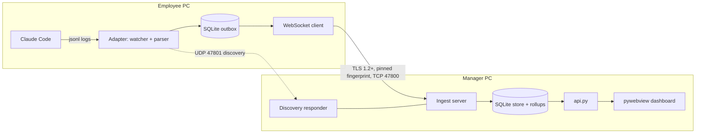

# TokenVault

Theo dõi mức dùng Claude Code của cả đội trong mạng nội bộ: **tài khoản Claude nào, dùng bao nhiêu token, ở dự án
nào, phiên nào, chi phí ước tính bao nhiêu** - không cần máy chủ hay dịch vụ đám mây, miễn phí.

TokenVault gồm hai ứng dụng Windows (Python 3.11+):

* **TokenVault Manager** - cài trên một máy của người quản lý: nhận dữ liệu, hiển thị bảng điều khiển, tạo gói cài đặt cho nhân viên. Chạy ở khay hệ thống.
* **TokenVault Adapter** - tác tử nhỏ chạy nền trên máy nhân viên: đọc nhật ký cục bộ của Claude Code (`~/.claude/projects`) và gửi số liệu (không gửi nội dung) về Manager.

## Kiến trúc



Chi tiết: [docs/architecture.md](docs/architecture.md).

## Ba cách phân phối

| Cách | Dành cho | Trạng thái |
|---|---|---|
| **Windows - bộ cài .exe** (Inno Setup, cài theo người dùng, Adapter không cần quyền admin) | máy chỉ có SmartScreen: "More info" -> "Run anyway" | Đã có (Task 10, 18) |
| **Windows - gói "no-exe"** (ZIP, Python embeddable có chữ ký của Python Software Foundation, `Install.cmd`) | máy chặn mọi exe chưa ký (Smart App Control / AppLocker) | **Đang triển khai (Task 25) - sẽ cập nhật sau khi hoàn thiện; chưa kiểm chứng** |
| **macOS - ZIP** (`TokenVault-Adapter-<team>-mac.zip`, `Install.command`) | máy Mac của nhân viên; build trên Mac | **Đang triển khai (Task 24) - sẽ cập nhật sau khi hoàn thiện; cần kiểm chứng trên Mac thật** |

Manager hiện chỉ chạy trên Windows 10 21H2+/11 (cần WebView2).

## Bắt đầu nhanh cho chủ quản lý

1. Cài **TokenVault-Manager-Setup.exe** trên một máy Windows bật suốt giờ làm việc. Một lần UAC để mở cổng tường lửa (47800 TCP, 47801 UDP). SmartScreen cảnh báo: "More info" -> "Run anyway".
2. Mở Manager. **Nên đặt IP tĩnh / giữ IP theo địa chỉ MAC** cho máy này (Cài đặt có gợi ý).
3. Vào trang **Tạo bộ cài**, nhập tên nhóm (ví dụ `Dev`) -> được `TokenVault-Adapter-Dev.exe`.
4. Gửi file cho nhân viên qua **thư mục chia sẻ mạng hoặc USB** (xem [packaging.md](docs/packaging.md) về SmartScreen) cùng [hướng dẫn nhân viên](docs/employee-guide.vi.md).
5. Khi nhân viên cài xong và dùng Claude Code, họ xuất hiện trong bảng điều khiển sau 1-2 giây.

Tài liệu: [Hướng dẫn quản lý](docs/manager-guide.vi.md) · [Xử lý sự cố](docs/troubleshooting.vi.md) · [Quyền riêng tư](docs/privacy.md) · [Kiến trúc](docs/architecture.md) · [Đóng gói](docs/packaging.md) · Nhân viên: [Tiếng Việt](docs/employee-guide.vi.md), [English](docs/employee-guide.en.md).

## Phát triển

```powershell
python -m venv .venv ; .venv\Scripts\python -m pip install -e ".[dev]"
powershell -File scripts\check.ps1     # ruff + mypy + pytest
```

Thiết kế: `docs/superpowers/specs/2026-11-19-tokenvault-design.md`. Kế hoạch: `docs/superpowers/plans/2026-11-19-tokenvault.md`.
