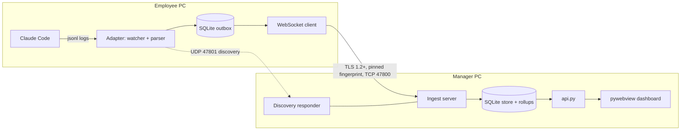

# TokenVault

Theo dõi mức dùng Claude Code của cả đội trong mạng nội bộ: **tài khoản Claude nào, dùng bao nhiêu token, ở dự án
nào, phiên nào, chi phí ước tính bao nhiêu** - không cần máy chủ hay dịch vụ đám mây, miễn phí.

TokenVault gồm hai ứng dụng Windows (Python 3.11+):

* **TokenVault Manager** - cài trên một máy của người quản lý: nhận dữ liệu, hiển thị bảng điều khiển, tạo gói cài đặt cho nhân viên. Chạy ở khay hệ thống.
* **TokenVault Adapter** - tác tử nhỏ chạy nền trên máy nhân viên: đọc nhật ký cục bộ của Claude Code (`~/.claude/projects`) và gửi số liệu (không gửi nội dung) về Manager.

## Kiến trúc



Chi tiết: [docs/architecture.md](docs/architecture.md).

## Ba cách phân phối

| Cách | Dành cho | Trạng thái |
|---|---|---|
| **Windows - gói "no-exe"** (mặc định; `TokenVault-Adapter-<team>-portable.zip`: Python embeddable do Python Software Foundation ký + mã nguồn TokenVault, `1-CAI-DAT.cmd`/`2-GO-CAI-DAT.cmd`) | mọi máy Windows, kể cả máy chặn exe chưa ký (Smart App Control / Application Control) | Đã có (Task 25), đã chạy thật trên máy phát triển; **chưa thử trên máy đang bị chặn thật**. Có sẵn khi cài Manager bằng bộ cài chuẩn (từ mã nguồn: chạy `build\build-portable.ps1` một lần) |
| **Windows - bộ cài .exe** (Inno Setup, cài theo người dùng, Adapter không cần quyền admin) | máy chỉ có SmartScreen: "More info" -> "Run anyway". Bị Smart App Control/WDAC chặn hẳn | Đã có và kiểm thử (Task 10, 18) |
| **macOS - ZIP** (`TokenVault-Adapter-<team>-mac.zip`: `Install.command`, `Uninstall.command`; biểu tượng menu bar bắt buộc, khoá trong Keychain, tự chạy bằng LaunchAgent) | máy Mac của nhân viên; mẫu build trên Mac bằng `build/build-mac.sh` | Đã có mã (Task 24), kiểm thử bằng giả lập trên Windows; **chưa kiểm chứng trên Mac thật** ([danh sách](docs/e2e-checklist.md)) |

### Gói nào cho máy nào?
| Máy nhân viên | Chọn | Ghi chú |
|---|---|---|
| Không chắc / mặc định | **portable (no-exe)** | Không có exe chưa ký nào trong gói; không cần quyền admin; chạy được cả khi máy chặn exe chưa ký |
| Windows bình thường, SmartScreen chỉ cảnh báo | **exe** | Bấm "More info" -> "Run anyway" |
| Windows bị Application Control / Smart App Control chặn exe chưa ký (không có nút "Run anyway", lỗi 4551) | **portable (no-exe)** bắt buộc | Xem [mục 9 xử lý sự cố](docs/troubleshooting.vi.md) |
| macOS 11+ | **mac** | Chuột phải `Install.command` -> Open |

Tránh Mark-of-the-Web: gửi file qua **thư mục chia sẻ mạng / USB / chat chuyển tệp**, không qua trình duyệt hay email. Chi tiết: [docs/packaging.md](docs/packaging.md).

Manager hiện chỉ chạy trên Windows 10 21H2+/11 (cần WebView2).

## Bắt đầu nhanh cho chủ quản lý

1. Cài **TokenVault-Manager-Setup.exe** trên một máy Windows bật suốt giờ làm việc. Bộ cài không đưa exe chưa ký nào vào máy: Manager chạy bằng Python đã ký số (`runtime\pythonw.exe -m tokenvault.manager`) nên không bị Smart App Control chặn. Một lần UAC để mở cổng tường lửa (47800 TCP, 47801 UDP); nếu lỡ từ chối, bấm lối tắt "Mở cổng tường lửa cho TokenVault (cần quyền admin)" trong Start menu. SmartScreen cảnh báo cho chính file Setup: "More info" -> "Run anyway"; nếu máy chặn hẳn cả file Setup (lỗi 4551) thì dùng `TokenVault-Manager-<version>.zip`.
2. Mở Manager. **Nên đặt IP tĩnh / giữ IP theo địa chỉ MAC** cho máy này (Cài đặt có gợi ý).
3. Vào trang **Tạo bộ cài**, nhập tên nhóm (ví dụ `Dev`), chọn hệ điều hành (mặc định **Windows – gói không cần exe** / Windows .exe / macOS) -> được `TokenVault-Adapter-Dev-portable.zip` (hoặc `.exe`, `-mac.zip`).
4. Gửi file cho nhân viên qua **thư mục chia sẻ mạng hoặc USB** (xem [packaging.md](docs/packaging.md) về SmartScreen) cùng [hướng dẫn nhân viên](docs/employee-guide.vi.md).
5. Khi nhân viên cài xong và dùng Claude Code, họ xuất hiện trong bảng điều khiển sau 1-2 giây.

Tài liệu: [Hướng dẫn quản lý](docs/manager-guide.vi.md) · [Xử lý sự cố](docs/troubleshooting.vi.md) · [Quyền riêng tư](docs/privacy.md) · [Kiến trúc](docs/architecture.md) · [Đóng gói](docs/packaging.md) · Nhân viên: [Tiếng Việt](docs/employee-guide.vi.md), [English](docs/employee-guide.en.md).

## Phát triển

```powershell
python -m venv .venv ; .venv\Scripts\python -m pip install -e ".[dev]"
powershell -File scripts\check.ps1     # ruff + mypy + pytest
```

Thiết kế: `docs/superpowers/specs/2026-11-19-tokenvault-design.md`. Kế hoạch: `docs/superpowers/plans/2026-11-19-tokenvault.md`.
